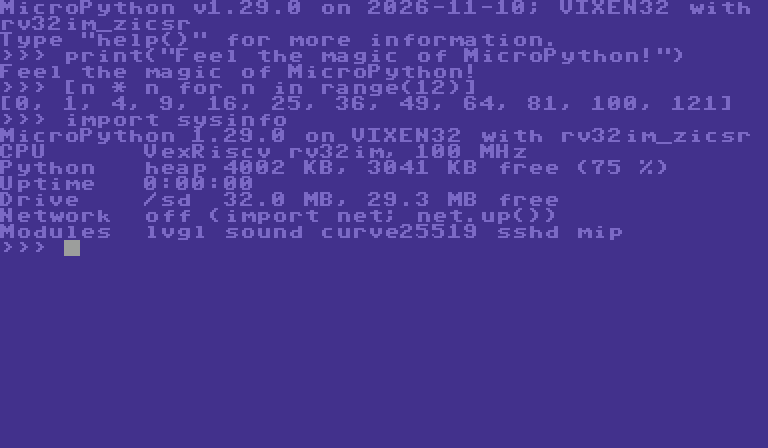
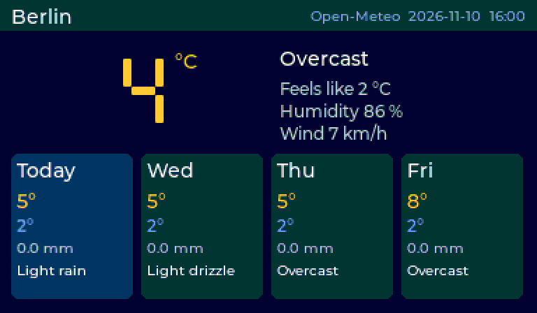
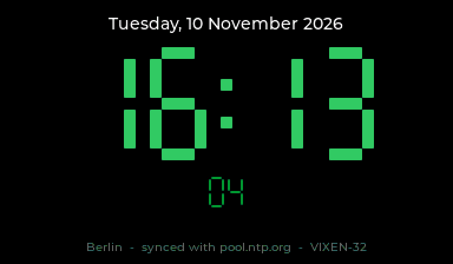
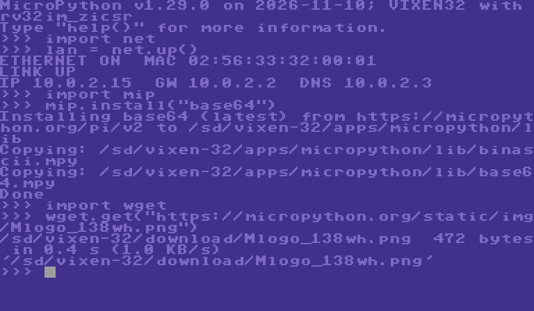
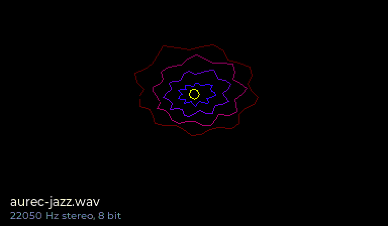
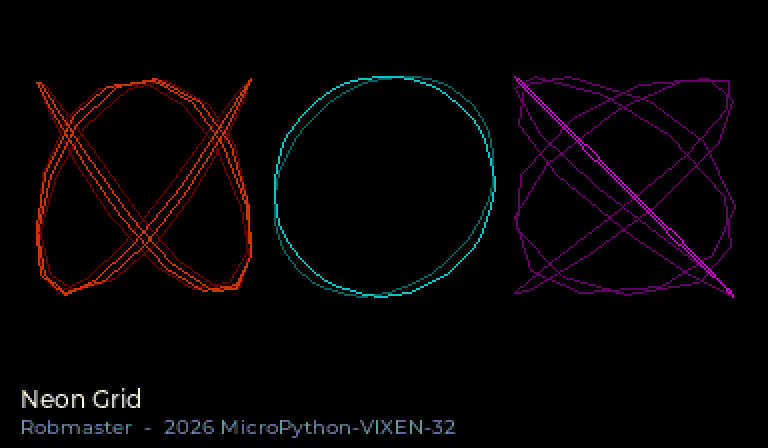
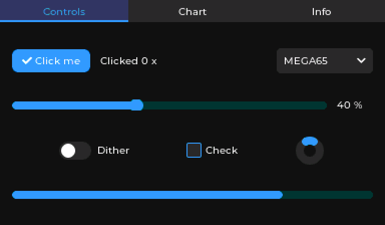
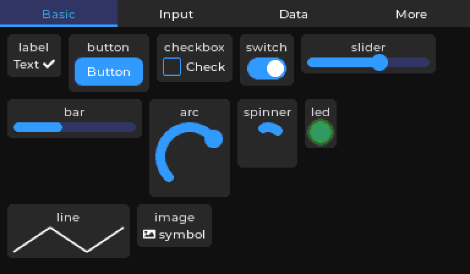

# MicroPython for the VIXEN-32

**Feel the magic of MicroPython and open source software -- on a 32-bit
RISC-V home computer that runs as a core on the MEGA65.**

Switch on, load one `.rvk`, and you have a full Python prompt on your MEGA65.
No compile cycle, no flashing. Type code, and it runs.

<p>


</p>

All screenshots are the real firmware at the VIXEN-32's native 384 x 224,
taken in the emulator.

## What it can do

**Fast development.** Write Python on the machine, or on your PC and send it
over. Change a line, run it again, done in seconds.

**SSH into the MEGA65.** `sshd.start()` and you are in: `ssh vixen@<ip>`
gives you the MicroPython REPL in your PC terminal. Press **Ctrl+E**, paste a
whole program from your editor, press **Ctrl+D**, and it runs on the MEGA65.
This is the fastest way to develop for the VIXEN-32.

**Copy files with scp and sftp.** `scp game.py vixen@<ip>:` and it is on the
SD card. scp and sftp reach 45-62 KB/s. Login by password or ed25519 key.

**Real networking.** DHCP or a static setup from the same `NETWORK.TXT` that
BASIC uses. TCP and UDP sockets, DNS, HTTP and HTTPS with `requests`.

**Install packages from the internet.** `mip.install("base64")` fetches from
micropython-lib or straight from GitHub, onto the SD card.

**A real GUI.** The LVGL build brings LVGL 9.3: buttons, sliders, charts,
tabs, lists -- 30 widgets. Mouse with a hardware sprite cursor, keyboard
navigation, PNG images, 50 frames per second.

**Sound.** `sound.wav.play("song.wav")` on the PCM engine.
`sound.sid.play("tune.sid")` plays C64 PSID/RSID tunes on the real SID chip,
with a 6502 running inside the player.

**Your SD card is just a folder.** `open()`, `os.listdir()`, `import` straight
from the card, plus the disk images in drives A: and B:. Long file names
included. The kernel stays in charge, so BASIC and Python share the card
safely.

**Autostart.** Put a `boot.py` and `main.py` on the card and your program
starts with the machine.

**Crypto built in.** SHA-256, AES, TLS, X25519 and Ed25519 in fast C, and a
seeded random generator behind `os.urandom`. An Ed25519 signature takes
87 ms.

**Tested.** An emulator runs the real firmware on your PC, with networking.
The test suite checks crypto against RFC vectors, HTTPS, `mip`, LVGL, and SSH
with the real OpenSSH client -- including paste mode.

## Get started

You need the VIXEN-32 core on your MEGA65, its devkit, and an rv32 GCC
(details in [docs/building.md](docs/building.md)).

```sh
VIXEN_DEVKIT=/path/to/vixen32-devkit ./setup.sh   # fetches MicroPython v1.29.0 + LVGL
./build.sh LVGL=1 BUILD=build-lvgl-net            # everything in one firmware
FW=ports/vixen/build-lvgl-net/firmware.elf tests/run_tests.sh   # optional: emulator tests
```

Copy `ports/vixen/build-lvgl-net/firmware.rvk` to the SD card and load it
from **F12/Help -> Load RVK**.

## Documentation

| Guide | |
| --- | --- |
| [Building and installing](docs/building.md) | toolchain, builds, SD card layout |
| [Networking](docs/network.md) | `net.up()`, `mip`, `requests`, sockets, crypto building blocks |
| [SSH server](docs/ssh.md) | REPL over SSH, scp, sftp, keys |
| [LVGL graphics](docs/lvgl.md) | GUI, mouse, keyboard, PNG, widget list |
| [Sound](docs/sound.md) | WAV and SID playback |
| [Architecture](docs/architecture.md) | memory layout, console, SD card, drivers |
| [Emulator](docs/emulator.md) and [testing](docs/testing.md) | develop and test on the PC |

## Examples

Copy them to `/vixen-32/apps/micropython/examples/` on the SD card, then
`import` them.

| | |
| --- | --- |
|  |  |
|  |  |
|  |  |

| Example | What it does |
| --- | --- |
| `weather.py` | current weather and a 4-day forecast for Berlin (or anywhere), from Open-Meteo |
| `clock.py` | big clock with the time from the internet (NTP), Berlin summer time included |
| `sysinfo.py` | version, memory, drives, network at a glance |
| `wget.py` | download any HTTP/HTTPS file straight onto the SD card |
| `lvgl_demo.py` | tabs, widgets, a live chart |
| `widgets_gallery.py` | every LVGL widget once, with a self-check |
| `png_demo.py` | load a PNG and drag it with the mouse |
| `sound_demo.py` | music you can see: the jazz WAV ripples as a rosette, the SID tune's three voices draw harmonograph figures from the notes they play. Includes "Neon Grid", an 80s crack-intro SID tune written for this project |
| `netbench.py` | measure network and SD card speed |
| `mouse_test.py` | check the mouse port |
| `bigdigits.py` | seven-segment digits for LVGL (used by clock and weather) |

## License

MIT, see [LICENSE](LICENSE). Built on [MicroPython](https://micropython.org)
(MIT), [LVGL](https://lvgl.io) and
[lv_binding_micropython](https://github.com/lvgl/lv_binding_micropython)
(MIT), lwIP (BSD) and Mbed TLS (Apache 2.0), all fetched by `setup.sh`.
Thank you to everyone behind them, and to the creators of the VIXEN-32 and
the MEGA65.
