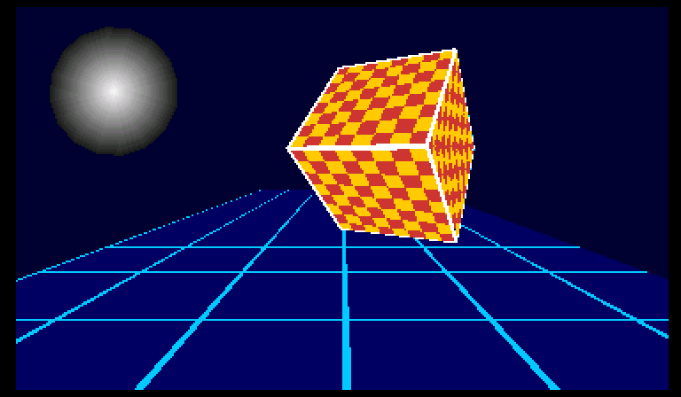
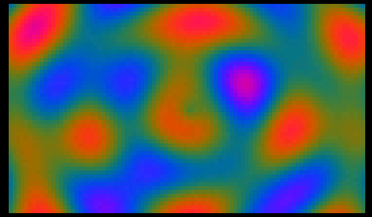

# gfx: the blitter from Python

The LVGL builds have a `gfx` module that draws with the VIXEN-32 blitter:
filled, Gouraud-shaded and textured triangles (each **one** blitter op,
core v0.93+), a Z buffer (v0.90+), perspective-correct textures (v0.91+),
rectangles, lines and sprite blits. Python only sets up each op; the blitter
draws it while Python works out the next one (its 256-deep op queue, v0.85+).

```python
import gfx

gfx.open()                      # 368 x 216, double buffered; hides the console
gfx.zbuffer(True)               # triangles need no sorting
orange = gfx.rgb(255, 128, 0)

gfx.clear(gfx.rgb(0, 0, 40))
gfx.tri((20, 20, 3), (200, 40, 3), (100, 180, 6), orange)
gfx.flip()                      # show it, tear-free
gfx.close()                     # back to the console
```

`import gfx_demo` shows a spinning textured cube over a moving floor, both
in perspective through the Z buffer, and a Gouraud disc; `import gfx_palette`
colour cycling with the 8 palettes.




## Screen and colours

| Call | |
| --- | --- |
| `gfx.open()` | the graphics screen: the console's area inside its margins (`gfx.size()`, `(368, 216)` by default), in the GFX layer. Clears both buffers, loads the palette |
| `gfx.close()` | GFX layer off, console back. A soft reset (Ctrl-D) closes it too |
| `gfx.flip()` | show what was drawn: waits for the blitter, the picture is taken at the next frame start. Drawing goes on in the other buffer and waits by itself until the flip has taken effect |
| `gfx.size()` | `(width, height)` |
| `gfx.rgb(r, g, b)` | the nearest palette index (0-255 each) |
| `gfx.zbuffer(on)` | Z test for triangles; `clear()` clears the Z buffer too |

The palette is the LVGL palette: a 6x6x6 colour cube (index = r * 36 +
g * 6 + b, each 0-5) and 40 greys at 216-255. `gfx` and LVGL share the
framebuffers in chip RAM, so they exclude each other within a session:
`gfx.open()` after `vixen.lv_display()` raises `RuntimeError` (Ctrl-D, then
`gfx`).

## Palettes, LUT and colour base

| Call | |
| --- | --- |
| `gfx.palette(i, r, g, b, bank=0)` | entry i (0-255) of palette bank 0-7 (core v0.95+) = r, g, b (0-255, kept as RGB565). Changing an entry the screen shows recolours every pixel of that index at once |
| `gfx.palette_cube(bank)` | the standard palette (what `gfx.rgb()` picks from) into a bank |
| `gfx.palette_show(bank)` | the picture shows that bank from the next frame; the border stays in bank 0 |
| `gfx.lut(table)` | `blit()` and `tri_tex()` write `table[pixel]` instead of the pixel: 256 bytes, `None` = off. Recolour sprites and textures without copying them |
| `gfx.color_base(n)` | n (0-255) is added to every pixel `blit()` and `tri_tex()` write (mod 256), before the LUT: a 16-colour image in any block of 16 entries with `color_base(16 * k)`. 0 = off |

The order per pixel: key test on the texture byte (a keyed pixel stays
transparent), then `+ color_base`, then the LUT. Fills, lines, flat and
Gouraud triangles use their colour as given. `gfx.open()` and
`gfx.close()` reset all of it (bank 0 shown, no LUT, base 0); the contents
of banks 1-7 stay.

`import gfx_palette` draws a plasma once and then only rotates the colours of
bank 1 -- demo-scene colour cycling.

## Drawing

Coordinates are pixels from the top left of the screen, ints or floats.
Everything is clipped to the screen.

| Call | |
| --- | --- |
| `gfx.clear(c=0)` | the whole screen (and the Z buffer) |
| `gfx.rect(x, y, w, h, c)` | filled rectangle, over everything (no Z test) |
| `gfx.line(x0, y0, x1, y1, c)` | line |
| `gfx.tri(p0, p1, p2, c)` | filled triangle; `p = (x, y)` or `(x, y, z)` |
| `gfx.tri_shade(p0, p1, p2)` | Gouraud: `p = (x, y, z, colour)`, the palette index runs smoothly between the corners -- use a ramp, e.g. the greys 216-255 |
| `gfx.tri_tex(p0, p1, p2, tex, persp=False, key=False)` | textured: `p = (x, y, z, u, v)`, u, v in texels. `persp=True`: the texture follows the depth (Quake-style, from 1/z at the corners). `key=True`: index 0 is transparent |
| `gfx.blit(tex, x, y, key=-1)` | copy a texture onto the screen (sprites); `key`: that index is transparent |

**z** is the distance from the eye: > 0, smaller = nearer (values below 1
count as 1). It matters for the Z buffer and for `persp`; the blitter keeps
32767 / z, so z from 1 to a few thousand works, finer near the eye. With
the Z buffer every pixel of a triangle is tested, so draw in any order.

The blitter draws both windings of a triangle: leave out back faces
yourself (see `gfx_demo.py`, `cube()`).

## Textures

```python
data = bytes(...)                     # w * h palette indices, row by row
tex = gfx.Texture(data, w, h)         # copied to chip RAM, where the blitter reads
tex.width, tex.height
tex.free()                            # or let the gc free it
```

Textures live in 128 KB of chip RAM (the third LVGL framebuffer); a full
texture is 256 x 256. When that is full, `gfx.Texture()` first lets the gc
free textures nobody holds, then raises `MemoryError`.

Triangles read textures from the blitter's 256 x 256 texture cache: up to
256 x 256 texels, and a texture repeats every **256** texels -- a floor or
wall that tiles needs a 256 x 256 texture (repeat a smaller tile inside it,
as `gfx_demo.py`'s `grid()` does). Switching textures reloads the cache
(a few microseconds, but it waits for the blitter first), so draw the
triangles of one texture together. `gfx.blit()` takes textures up to
384 x 256.

## Speed and limits

* Each call costs Python's call overhead plus the triangle set-up (a few
  divides); the blitter's own time runs beside it. `gfx_demo.py` draws ~60
  triangles a frame (42 textured in perspective, 16 Gouraud).
* Corners must stay within -1024 .. 1023 pixels (the blitter's range);
  triangles beyond that draw wrongly. Clip big geometry in Python first.
