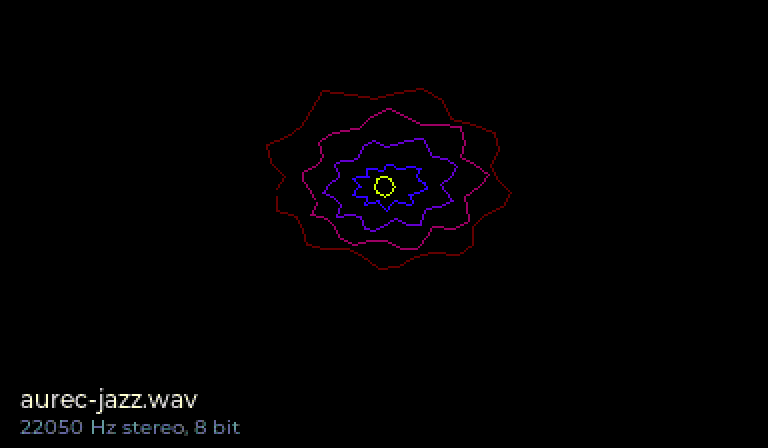
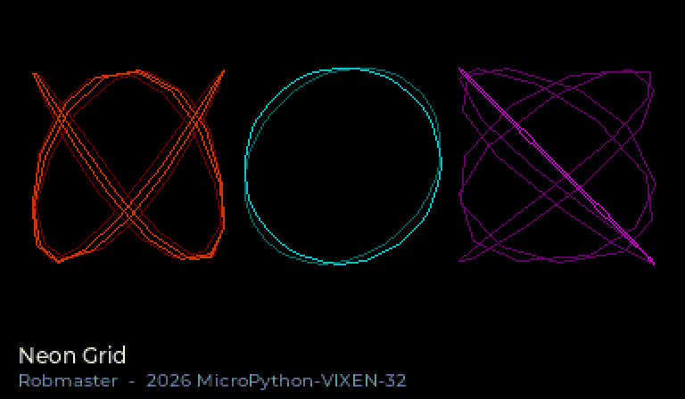

# Sound: WAV and SID

The `sound` module plays WAV files on the VIXEN-32 PCM engine and C64 SID
tunes on the VIXEN SID.

## Firmware

`sound` is included in every build with the network or LVGL (see
[Building](building.md)):

```sh
./build.sh BUILD=build-net                    # network + sound
./build.sh LVGL=1 BUILD=build-lvgl-net        # LVGL + network + sound
./build.sh LVGL=1 NET=0 BUILD=build-lvgl      # LVGL + sound
```

A build with neither (`NET=0`, no LVGL) has no sound: the player lives in the
chip-RAM code block, which only those builds have.

## Usage

```python
import sound

sound.wav.play("music/intro.wav")         # plays in the background
sound.wav.play("loop.wav", loop=True)     # repeats forever
sound.wav.stop()

sound.sid.play("music/giana.sid")          # the file's default song
sound.sid.play("music/giana.sid", song=5)  # sub-tune 5
sound.sid.stop()

sound.wav.playing()   # True/False
sound.sid.playing()
```

WAV and SID play at the same time (separate hardware). Instead of a file name
you can pass a `bytes` object, e.g. straight from `requests.get(url).content`.

A soft reset (Ctrl+D) silences both. RUN/STOP does **not** stop the music;
call `stop()` for that (see `examples/sound_demo.py`, which stops playback
when interrupted).

## Music you can see: sound_demo.py

```python
import sound_demo                              # starts it: neon_grid.sid, then aurec-jazz.wav
sound_demo.art()                               # once more
sound_demo.art("neon_grid.sid")                          # one file: WAV or SID
sound_demo.art("/sd/music/tune.sid", seconds=60)
sound_demo.play_all("/sd/sids", seconds=60)    # plain playback of a folder
```

Copy `sound_demo.py`, `aurec-jazz.wav` and `neon_grid.sid` to the examples folder.
In the LVGL build `art()` draws the music while it plays:

* **WAV -> rosette.** The demo reads the real samples straight from the
  sound module's buffer in chip RAM, at the current playback position. Left
  and right channel bend a ring of 40 points; every frame the ring moves
  outward and fades, so the music ripples away from a core that pulses with
  the loudness. The colour drifts faster when it gets loud.
* **SID -> harmonograph.** The demo reads the SID registers from the
  player's register shadow. Each of the three voices draws a Lissajous
  figure: the note decides the frequency ratio of the figure (a fifth is a
  calm 2:3, other intervals weave denser patterns), the octave how fast it
  turns, gate and master volume how big it is. Noise makes it shiver. Two
  dimmer trails show where it just was.

<p>


</p>

**How it stays fast.** Drawing big line figures through LVGL is slow on a
100 MHz CPU: LVGL renders in 24-pixel bands and works out every line again
for each band (measured: ~0.3 s per frame). So the demo draws like a real
crack intro: LVGL renders the background and the titles into its three
framebuffers once, then the blitter's hardware line engine draws the
figures and the demo flips the buffers itself (`machine.mem32` on the
blitter and `GFX_PTR` registers), about 70-80 ms per frame on the hardware.
LVGL gets the display back when the music ends.

The WAV pictures cost no audio time (the PCM engine plays by itself). The SID
player runs between Python bytecodes; if a tune stumbles, lower the frame
rate: `sound_demo.art("neon_grid.sid", fps=10)`.
Without LVGL, `art()` just plays the files.

Music included: `neon_grid.sid` and `aurec-jazz.wav`.

## Neon Grid: a tune of our own

`neon_grid.sid` was written for this project and is MIT licensed like the
rest of it: an 80s crack-intro tune at 125 BPM in A minor, 16 bars, 30.7 s
loop. Voice 1 plays an octave-jumping 16th bass with pulse-width modulation
through a resonant low-pass filter that sweeps open and shut; voice 3 plays
50 Hz chord arpeggios on the offbeats with a pitch-drop kick and a noise
snare in between; voice 2 joins in bar 5 with the lead -- pulse with PWM, a
little bend into every note and vibrato on the long ones.

Its source is `ports/vixen/tools/sidtune/compose.py`: the score as Python
lists, and Python code that computes every frame -- arpeggios, vibrato,
PWM, drums, the filter sweep -- as SID register writes. The 6502 player only
streams them (58 bytes), so any effect is a few lines of Python.
Change a note, run it, and you have a new `.sid`:

    python3 ports/vixen/tools/sidtune/compose.py ports/vixen/examples/neon_grid.sid

To hear a tune on the PC (a rough model of the chip):

    cc -O2 -o sidplay ports/vixen/tools/sidtest/sidplay.c
    SIDLOG=writes.txt ./sidplay ports/vixen/examples/neon_grid.sid 0 40
    python3 ports/vixen/tools/sidtune/preview.py writes.txt preview.wav

## WAV

* Integer PCM, 8/16/24/32 bit, mono or stereo, any sample rate.
* The file is loaded completely into chip RAM, then the PCM engine plays it on
  its own: **no CPU time** while it plays. Loading takes as long as reading
  the file from the card.
* At most 48 kHz (hardware limit); higher rates such as 96 kHz are decimated
  while loading.
* Stereo: the hardware only offers 75/25 panning, no hard left/right.
* Room: ~4.4 MB, about 47 s at 48 kHz/16 bit/mono (stereo: half). If the file
  does not fit as 16 bit, it is stored as 8 bit (twice the length, slightly
  noisier). Longer still gives `ValueError: WAV too long`; reduce the sample
  rate then (22 kHz mono fits more than 3 minutes in 8 bit).

## SID

* PSID and RSID files. A 6502 emulator runs the tune's music code; whatever it
  writes to `$D400-$D7FF` goes to the VIXEN SID.
* Pitch is correct: the VIXEN SID runs at 1 MHz, the C64 at 0.985 MHz (PAL) or
  1.023 MHz (NTSC), and frequencies are converted.
* Tempo: 50 Hz, or the raster/CIA rate the tune sets up.
* Timing: the player runs 4 ms ahead; each SID write is time-stamped with the
  moment the C64 would have made it and is sent to the SID at exactly that
  time, so writes are spread over the frame as on a C64. Raster line and CIA
  timer follow the same virtual clock.
* CPU cost while a tune plays is estimated at 3-5 %; nothing while it is
  silent.
* The port has no interrupts: the player is called from the keyboard/network
  polling. While your program runs normally or sleeps in `time.sleep()`, the
  music keeps playing. If a single C function blocks for more than a few
  milliseconds (large file access, an LVGL redraw), the tune stumbles briefly.
* Not supported: NMI tunes (CIA 2 digis), 2SID/3SID, BASIC tunes.

## Memory

All sound code (player, 6502 emulator, WAV loader) lives in chip RAM. In BRAM
the module costs only its names and the polling hook (176 bytes in the network
build, 40 bytes in the LVGL build). Existing code does not get slower: while
nothing plays, the cost is a single byte test per poll.

## Quick check

1. `sound.sid.play("<path>/Great_Giana_Sisters.sid")`: music at the right tempo
   and pitch? Try `song=5`.
2. A PSID and an RSID tune.
3. A WAV with 44.1 kHz/16 bit/stereo and one with 8 bit mono.
4. While a SID plays, run `import widgets_gallery` (LVGL build): the music may
   stumble briefly on redraws but should keep going.
5. Ctrl+D while music plays: silence.
