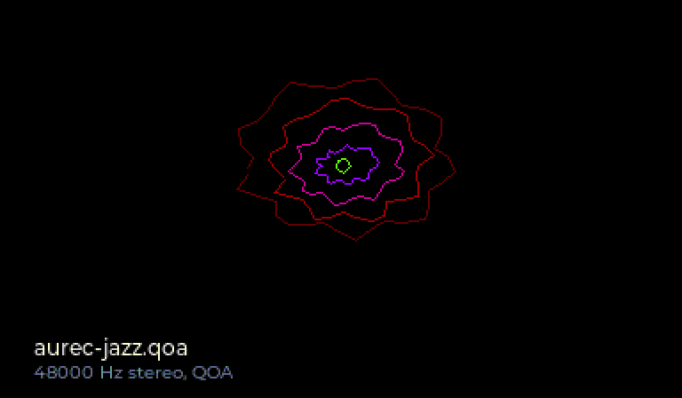
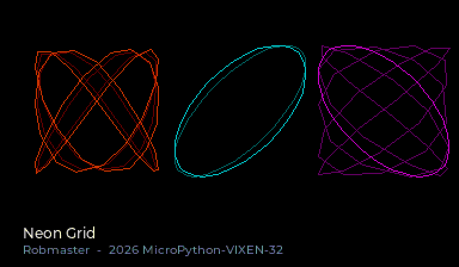

# Sound: WAV, QOA and SID

The `sound` module plays WAV and QOA files on the VIXEN-32 PCM engine and
C64 SID tunes on the VIXEN SID.

**Just want to play your music?** Copy it to `/sd/vixen-32/music/` and type
`import folderplay` -- see [Your music: folderplay.py](#your-music-folderplaypy).

## Firmware

`sound` is included in every build with the network or LVGL (see
[Building](building.md)):

```sh
./build.sh BUILD=build-net                    # network + sound
./build.sh LVGL=1 BUILD=build-lvgl-net        # LVGL + network + sound
./build.sh LVGL=1 NET=0 BUILD=build-lvgl      # LVGL + sound
```

A build with neither (`NET=0`, no LVGL) has no sound: the player lives in the
chip-RAM code block, which only those builds have.

## Usage

```python
import sound

sound.qoa.play("/sd/vixen-32/music/song.qoa")   # plays in the background
sound.sid.play("/sd/vixen-32/music/tune.sid")   # at the same time
sound.qoa.pause()
sound.qoa.resume()
sound.qoa.stop(); sound.sid.stop()
```

Three sub-modules, each with the same six functions:

| | `sound.wav` | `sound.qoa` | `sound.sid` |
|---|---|---|---|
| plays | WAV files | QOA files | C64 SID tunes |
| on | the PCM engine | the PCM engine (shared with `wav`) | the SID chip |
| `play()` | `play(src, loop=False, stream=None)` | `play(src, loop=False, stream=None)` | `play(src, song=0)` |
| `stop()` | yes | yes | yes |
| `playing()` | yes | yes | yes |
| `pause()` / `resume()` / `paused()` | yes | yes | yes |

### sound.wav.play() and sound.qoa.play()

    sound.wav.play(src, loop=False, stream=None)
    sound.qoa.play(src, loop=False, stream=None)

Starts a WAV or QOA file and returns while it plays in the background. Both
take the same arguments:

* `src` -- a file name, or a `bytes` object with the whole file (read into
  memory, or a download straight from `requests.get(url).content`).
* `loop` -- `False` (default): play once and stop at the end. `True`: start
  again at the end, until `stop()`.
* `stream` -- how the file gets to the PCM engine (see
  [Loaded or streamed](#loaded-or-streamed-the-ring-buffer)):
  * `None` (default): load the file completely into memory if it fits,
    otherwise stream it from the card through the ring buffer.
  * `True`: always stream. `play()` returns after about a second instead of
    loading the whole file first.
  * `False`: never stream. A file too long for memory raises
    `ValueError: WAV too long`.

```python
sound.wav.play("intro.wav")                          # load (fits), play once
sound.wav.play("intro.wav", loop=True)               # play it again and again
sound.wav.play("album.wav")                          # too long for memory: streams by itself
sound.wav.play("intro.wav", stream=True)             # stream although it fits: returns at once
sound.wav.play("intro.wav", stream=False)            # load or fail, never stream
sound.wav.play(open("intro.wav", "rb").read())       # from memory

sound.qoa.play("song.qoa")                           # the same for QOA
sound.qoa.play("song.qoa", loop=True)
sound.qoa.play("song.qoa", stream=True)
sound.qoa.play("song.qoa", stream=True, loop=True)   # stream and repeat
sound.qoa.play("song.qoa", stream=False)
```

A file that cannot be played raises `ValueError` (unsupported format, a
streamed file above 48 kHz) or `OSError` (file not found).

### sound.sid.play()

    sound.sid.play(src, song=0)

Starts a SID tune (PSID or RSID); it plays until `stop()` -- a SID tune has
no end.

* `src` -- a file name or a `bytes` object.
* `song` -- the sub-tune, counted from 1; `0` (default) is the one the file
  names as its default. A number the file does not have raises
  `ValueError: no such song`.

```python
sound.sid.play("giana.sid")             # the default sub-tune
sound.sid.play("giana.sid", song=5)     # sub-tune 5
```

### stop(), playing(), pause(), resume(), paused()

The same for all three sub-modules:

| Function | What it does |
|---|---|
| `stop()` | Stops the music (also a paused one). Nothing playing: does nothing. |
| `playing()` | `True` from `play()` until the end of the file or `stop()` -- **also while paused**. |
| `pause()` | Holds the music where it is: silence. Nothing playing, or already paused: does nothing. |
| `resume()` | Plays on from where `pause()` stopped. Not paused: does nothing. |
| `paused()` | `True` between `pause()` and `resume()`/`stop()`. |

```python
import sound, time

sound.qoa.play("song.qoa")
while sound.qoa.playing():              # wait for the end
    time.sleep(0.1)
```

### WAV, QOA and SID together

* WAV and QOA share the PCM engine: playing one stops the other.
  `sound.wav.stop()` and `sound.qoa.stop()` are the same function, and so are
  `playing()`, `pause()`, `resume()` and `paused()` -- they act on whichever
  of the two is playing.
* WAV/QOA and SID play at the same time (separate hardware), and pause
  independently.
* A soft reset (Ctrl+D) silences everything. RUN/STOP does **not** stop the
  music; call `stop()` for that (`examples/sound_demo.py` stops playback when
  interrupted).

## Loaded or streamed: the ring buffer

WAV and QOA use a window of ~4.4 MB of chip RAM (`0x380000-0x7F0000`) in two
ways:

**Loaded.** A file that fits is decoded completely into the window before
`play()` returns; then the PCM engine plays it on its own -- **no CPU time**
while it plays. Room: about 47 s of 48 kHz 16-bit mono (stereo: half). A
file that does not fit as 16 bit is stored as 8 bit (twice the length,
slightly noisier).

**Streamed.** A file that does not fit even as 8 bit, one whose length is
unknown, or any file with `stream=True` streams: the window becomes a **ring
buffer** of 16-bit samples, ~23 s of 48 kHz stereo (~46 s mono). The engine
plays it round and round; the firmware reads the file on and writes the next
samples behind the playback position. Any length plays, `play()` returns
after about a second, and it costs CPU time while it plays.

```
        played, free again          ahead (up to 8 s)       guard 1/8
ring  [ ........................ |>>>>>>>>>>>>>>>>>>>>>>| ......... ]
                          playback position        written up to here
```

* **Who fills it.** The polling that also runs the SID player -- the VM hook
  between bytecodes, `time.sleep()`, the REPL's input wait -- reads the next
  2 KB of the file, decodes it and writes it into the ring. No Python code is
  needed; your program just has to keep running or sleeping.
* **How far ahead.** Up to 8 s; the rest of the ring is filled slowly (one
  read per frame). The lead grows with the time played: right after the
  start one second is ahead, then every poll reads until the lead is half the
  time played. Filling all 8 s at once had taken most of the CPU for the
  first seconds -- the pictures of `sound_demo` stuttered.
* **Where it plays.** The engine has no position register: the position is
  counted from the raster clock (measured on the hardware: 120.0 s of
  `time.sleep(120)` took 120.0 s). A guard of 1/8 of the ring keeps the
  writes away from the samples still to be played.
* **End.** At the end of the file the ring is filled with silence and
  playback stops on time; `loop=True` seeks back to the start of the data.
* **Blocking.** C code that blocks for longer than what is buffered (a huge
  `f.read()`, a long LVGL redraw) lets the engine run into old data.
* The file stays open while it streams, so the SD card stays claimed by the
  kernel until it ends.
* **CPU time** while a file streams (measured on the hardware, a Python loop
  counting): 22 kHz stereo IMA ADPCM ~26 %, 22 kHz stereo 16-bit PCM ~60 %,
  48 kHz stereo QOA ~40 % (the first two with 1 KB per read). Most of it is
  the SD card: every separate read costs ~5 ms on top of the transfer,
  however small. Larger reads cost less time but block longer -- and while
  the poll blocks, the SID player cannot give out its writes (it runs only
  4 ms ahead). Measured with 48 kHz stereo QOA and a SID tune at once:

  | Bytes per read | Python keeps | Longest block |
  |---|---|---|
  | 1 KB | 51 % | 11 ms |
  | **2 KB (default)** | **60 %** | **14 ms** |
  | 4 KB | 70 % | 20 ms |

  For long music use QOA or IMA ADPCM and a modest rate.

## Pause

`pause()` holds the music where it is, `resume()` plays on from that spot.
Pausing when nothing plays, or twice, does nothing; `stop()` also ends a
pause.

```python
sound.qoa.play("/sd/vixen-32/music/song.qoa")
sound.qoa.pause()      # silence
sound.qoa.paused()     # True; playing() stays True
sound.qoa.resume()     # on from the same spot
```

* WAV/QOA: the engine's pitch and volume go to 0 -- it reads its control
  words live, so the sample position stays put and nothing is restarted. A
  streamed file keeps its ring buffer and reads nothing while paused; a
  loaded file ends that much later.
* SID: the player stops and the SID's master volume goes to 0 (the filter
  bits stay); on `resume()` the volume returns and the tune goes on at its
  tempo, it does not catch up on the pause.

## Music you can see: sound_demo.py

```python
import sound_demo                              # starts it: neon_grid.sid, then aurec-jazz.qoa
sound_demo.art()                               # once more
sound_demo.art("neon_grid.sid")                          # one file: WAV, QOA or SID
sound_demo.art("/sd/music/tune.sid", seconds=60)
sound_demo.play_all("/sd/sids", seconds=60)    # plain playback of a folder
```

Keys while `art()` plays: the same as in [folderplay](#your-music-folderplaypy)
(SPACE pause/play, n next, p previous, RUN/STOP ends).

Copy `sound_demo.py`, `aurec-jazz.qoa` and `neon_grid.sid` to the examples folder.
In the LVGL build `art()` draws the music while it plays:

* **WAV or QOA -> rosette.** The demo reads the real samples straight from the
  sound module's buffer in chip RAM, at the current playback position. Left
  and right channel bend a ring of 40 points; every frame the ring moves
  outward and fades, so the music ripples away from a core that pulses with
  the loudness. The colour drifts faster when it gets loud.
* **SID -> harmonograph.** The demo reads the SID registers from the
  player's register shadow. Each of the three voices draws a Lissajous
  figure: the note decides the frequency ratio of the figure (a fifth is a
  calm 2:3, other intervals weave denser patterns), the octave how fast it
  turns, gate and master volume how big it is. Noise makes it shiver. Two
  dimmer trails show where it just was.

<p>


</p>

**How it stays fast.** Drawing big line figures through LVGL is slow on a
100 MHz CPU: LVGL renders in 24-pixel bands and works out every line again
for each band (measured: ~0.3 s per frame). So the demo draws like a real
crack intro: LVGL renders the background and the titles into its three
framebuffers once, then the blitter's hardware line engine draws the
figures and the demo flips the buffers itself (`machine.mem32` on the
blitter and `GFX_PTR` registers), about 70-80 ms per frame on the hardware.
LVGL gets the display back when the music ends.

The WAV pictures cost no audio time (the PCM engine plays by itself). The SID
player runs between Python bytecodes; if a tune stumbles, lower the frame
rate: `sound_demo.art("neon_grid.sid", fps=10)`.
Without LVGL, `art()` just plays the files.

Music included: `neon_grid.sid` and `aurec-jazz.qoa` (the complete 1:55 min track, QOA, 48 kHz stereo as in the original, 4.4 MB; it streams from the card).

## Your music: folderplay.py

`folderplay` plays every music file in one folder of the SD card, one after
the other, with the pictures of `sound_demo` -- a music player in three steps.

**1. Copy the music to the card.** WAV, QOA and SID files go to
`/sd/vixen-32/music/` (create it once, e.g. `os.mkdir("/sd/vixen-32/music")`). MP3 or FLAC first become QOA
on the PC with [mkqoa.py](#from-mp3flac-mkqoapy):

```sh
ports/vixen/tools/mkqoa/mkqoa.py ~/Music/album -o out/
scp -O out/*.qoa vixen@<ip>:/sd/vixen-32/music/
```

`folderplay.py` and `sound_demo.py` must be in the examples folder
(`/sd/vixen-32/apps/micropython/examples/`).

**2. Start it** at the MicroPython prompt:

```
>>> import folderplay
2 file(s) in /sd/vixen-32/music
 1. 01-neon-grid.sid
 2. 02-aurec-jazz.qoa
SPACE pause/play, n next, p previous, RUN/STOP ends
playing /sd/vixen-32/music/01-neon-grid.sid
```

It lists the files in name order (upper/lower case ignored -- number them
`01-...`, `02-...` for your own order) and plays them one after the other:
a WAV or QOA to its end, a SID tune for 62 seconds (a SID tune has no
end; `sid_seconds` changes it).
After the last file it stops and returns to the prompt.

**3. Control it** with the keyboard or over the SSH console:

| Key | |
|---|---|
| **SPACE** | pause -- music and picture stop; SPACE again plays on from the same spot |
| **n** | next track |
| **p** | previous track (on the first track: it starts again) |
| **RUN/STOP** (Ctrl-C over SSH) | end: the music stops, back to the prompt |

### Options

`import folderplay` runs once; a second `import` does nothing. To play again,
or differently, call `folderplay.play()`:

```python
folderplay.play()                                # once more
folderplay.play(shuffle=True)                    # random order
folderplay.play(repeat=True)                     # start again after the last track, until RUN/STOP
folderplay.play(shuffle=True, repeat=True)       # radio: a new random order each round
folderplay.play("/sd/other")                     # another folder
folderplay.play(sid_seconds=120)                 # a SID tune plays 2 minutes
folderplay.play(fps=10)                          # fewer pictures per second (more CPU for a SID)
```

| Argument | Default | |
|---|---|---|
| `folder` | `"/sd/vixen-32/music"` | the folder to play |
| `shuffle` | `False` | random order |
| `repeat` | `False` | start again after the last file |
| `sid_seconds` | `None` = 62 s | how long a SID tune plays |
| `fps` | `25` | pictures per second |

`folderplay.files()` returns the list it would play.

### Notes

* Pictures need the LVGL build; without LVGL the files just play.
* Files with other endings are ignored; a `.wav`/`.qoa`/`.sid` the sound
  module cannot play (another codec, a damaged file) is skipped with a
  message.
* Names with Latin-1 characters (a PC copy of `Bär.qoa`) are listed and
  opened like any other name.
* The card's scp cuts a file name at its first space ("01 Neon Grid.sid"
  arrives as "01"). Use names without spaces; `mkqoa.py` writes `_` instead.
* Long QOA files stream from the card while they play; the file stays open
  until playback ends.

### From MP3/FLAC: mkqoa.py

`ports/vixen/tools/mkqoa/mkqoa.py` turns anything ffmpeg reads (MP3, FLAC,
OGG, M4A, ...) into QOA:

```sh
ports/vixen/tools/mkqoa/mkqoa.py ~/Music/album -o out/     # every audio file in a folder
ports/vixen/tools/mkqoa/mkqoa.py song.flac -r 22050 --mono # smaller
ports/vixen/tools/mkqoa/mkqoa.py song.mp3 --adpcm          # IMA ADPCM WAV, needs only ffmpeg
scp -O out/*.qoa vixen@<ip>:/sd/vixen-32/music/
```

* Needs ffmpeg/ffprobe and a C compiler. ffmpeg reads QOA but cannot write
  it, so the reference encoder `qoa.h` (MIT, vendored in the same folder)
  does the encoding; `qoaenc.c` is compiled with `$CC` on the first run and
  kept in `~/.cache/vixen-mkqoa`.
* Rate: the source's, at most 48000; more than 2 channels are mixed down to
  stereo. 1 minute of 48 kHz stereo is ~2.3 MB.
* Existing outputs are skipped (`-f` overwrites).

## Neon Grid: a tune of our own

`neon_grid.sid` was written for this project and is MIT licensed like the
rest of it: an 80s crack-intro tune at 125 BPM in A minor, 16 bars, 30.7 s
loop. Voice 1 plays an octave-jumping 16th bass with pulse-width modulation
through a resonant low-pass filter that sweeps open and shut; voice 3 plays
50 Hz chord arpeggios on the offbeats with a pitch-drop kick and a noise
snare in between; voice 2 joins in bar 5 with the lead -- pulse with PWM, a
little bend into every note and vibrato on the long ones.

Its source is `ports/vixen/tools/sidtune/compose.py`: the score as Python
lists, and Python code that computes every frame -- arpeggios, vibrato,
PWM, drums, the filter sweep -- as SID register writes. The 6502 player only
streams them (58 bytes), so any effect is a few lines of Python.
Change a note, run it, and you have a new `.sid`:

    python3 ports/vixen/tools/sidtune/compose.py ports/vixen/examples/neon_grid.sid

To hear a tune on the PC (a rough model of the chip):

    cc -O2 -o sidplay ports/vixen/tools/sidtest/sidplay.c
    SIDLOG=writes.txt ./sidplay ports/vixen/examples/neon_grid.sid 0 40
    python3 ports/vixen/tools/sidtune/preview.py writes.txt preview.wav

## WAV

* Integer PCM, 8/16/24/32 bit, mono or stereo, any sample rate.
* IMA ADPCM (4 bit), 4x smaller than 16-bit PCM -- see below.
* Loaded completely or streamed through the ring buffer, see
  [Loaded or streamed](#loaded-or-streamed-the-ring-buffer).
* At most 48 kHz (hardware limit); higher rates such as 96 kHz are decimated
  while loading (a streamed file must be 48 kHz or less).
* Stereo: the hardware only offers 75/25 panning, no hard left/right.

### IMA ADPCM: smaller files

An IMA ADPCM WAV stores 4 bits per sample instead of 16: a quarter of the
size on the card, over scp and when downloaded. Make one with ffmpeg:

```sh
ffmpeg -i song.flac -ac 1 -ar 22050 -c:a adpcm_ima_wav song.wav
```

```python
sound.wav.play("song.wav")                # nothing else changes
```

* The loader decodes the file to 16 bit while reading it. In chip RAM it
  takes as much room as a 16-bit WAV, so the playing time that fits is the
  **same** (the PCM engine only plays 8 and 16 bit); a longer file streams
  through the [ring buffer](#loaded-or-streamed-the-ring-buffer). Loaded completely, playback costs no CPU time.
* Decoding speed on the hardware: ~0.9 us per sample (the decoder loop runs
  from BRAM); 18 s of 22 kHz stereo load in ~2.2 s, of which ~1.6 s is
  reading the card.
* Decoding rounds exactly like ffmpeg: an ffmpeg file comes out bit for bit
  as ffmpeg decodes it. Files from encoders that round like the IMA reference
  (sox, Windows) are a few LSB off -- inaudible.
* Mono or stereo, any rate (above 48 kHz decimated), blocks up to 4096
  bytes. The `fact` chunk sets the exact length; without it the whole data
  chunk plays, padding of the last block included.
* Only IMA ADPCM (format tag 0x11), not Microsoft ADPCM (0x02) or 3-bit IMA.

## QOA

[QOA, the "Quite OK Audio" format](https://qoaformat.org/) by Dominic
Szablewski: lossy, 3.2 bits per sample -- a fifth of 16-bit PCM, better
sound than IMA ADPCM at a smaller size. `sound.qoa.play()` takes the same
arguments as `sound.wav.play()`; a QOA file is loaded or streamed through the
ring buffer just as a WAV ([Loaded or streamed](#loaded-or-streamed-the-ring-buffer)).

* Make one with `mkqoa.py` (above).
* Mono or stereo, any rate (above 48 kHz decimated when loaded). Files with
  more than 2 channels, and "streaming" QOA files without a length, are
  refused (`ValueError`).
* Decoding follows the reference `qoa.h` bit for bit. Speed on the hardware:
  ~0.95 us per sample (the decoder loop and its table run from BRAM); 10 s of
  48 kHz stereo load in ~0.92 s.
* Streaming 48 kHz stereo (`aurec-jazz.qoa`) takes ~40 % of the CPU, Python
  keeps ~60 % (2 KB per read; see the table under
  [Loaded or streamed](#loaded-or-streamed-the-ring-buffer)).

## SID

* PSID and RSID files. A 6502 emulator runs the tune's music code; whatever it
  writes to `$D400-$D7FF` goes to the VIXEN SID.
* Pitch is correct: the VIXEN SID runs at 1 MHz, the C64 at 0.985 MHz (PAL) or
  1.023 MHz (NTSC), and frequencies are converted.
* Tempo: 50 Hz, or the raster/CIA rate the tune sets up.
* Timing: the player runs 4 ms ahead; each SID write is time-stamped with the
  moment the C64 would have made it and is sent to the SID at exactly that
  time, so writes are spread over the frame as on a C64. Raster line and CIA
  timer follow the same virtual clock.
* CPU cost while a tune plays is estimated at 3-5 %; nothing while it is
  silent.
* The port has no interrupts: the player is called from the keyboard/network
  polling. While your program runs normally or sleeps in `time.sleep()`, the
  music keeps playing. If a single C function blocks for more than a few
  milliseconds (large file access, an LVGL redraw), the tune stumbles briefly.
* Not supported: NMI tunes (CIA 2 digis), 2SID/3SID, BASIC tunes.

## Memory

All sound code (player, 6502 emulator, WAV loader, streaming) lives in chip
RAM, except the ADPCM and QOA decoder loops and their tables (BRAM: from
chip RAM they ran half as fast). In BRAM
the module costs only its names and the polling hook (176 bytes in the network
build, 40 bytes in the LVGL build). Existing code does not get slower: while
nothing plays, the cost is a single byte test per poll.

## Quick check

Things to try on the hardware after a change to the sound code; what you
should see or hear follows the arrow.

1. `sound.sid.play("<path>/Great_Giana_Sisters.sid")` -> music at the right
   tempo and pitch. With `song=5` -> another sub-tune.
2. A PSID and an RSID tune -> both play.
3. A WAV with 44.1 kHz/16 bit/stereo, one with 8 bit mono and an IMA ADPCM
   WAV from ffmpeg (`-c:a adpcm_ima_wav`) -> each sounds clean.
4. A WAV of several minutes -> it streams: no gaps, ends on time,
   `sound.wav.playing()` turns False at the end. A short one with
   `stream=True` -> the same; with `loop=True` -> it starts again.
5. `import sound_demo` -> the SID tune with its figures, then
   `aurec-jazz.qoa` (streamed) with the rosette: clean sound, and the
   rosette moves smoothly from the first second on.
6. Pause, for a WAV, a QOA and a SID in turn: `play(...)`, then `pause()` ->
   silence, `paused()` is True; wait a few seconds, `resume()` -> it goes on
   from where it stopped, without a click.
7. While a SID plays, run `import widgets_gallery` (LVGL build) -> the music
   may stumble briefly on redraws but keeps going.
8. Ctrl+D while music plays -> silence.
9. Copy two or three files to `/sd/vixen-32/music/` (e.g. `neon_grid.sid`
   and `aurec-jazz.qoa`), then `import folderplay` -> it lists them and
   plays the first. Press SPACE -> music and picture stop; SPACE again -> on
   from the same spot. `n` -> the next file starts; `p` -> back to the
   previous one (on the first file: it starts again). RUN/STOP -> back to
   the prompt, silence.
