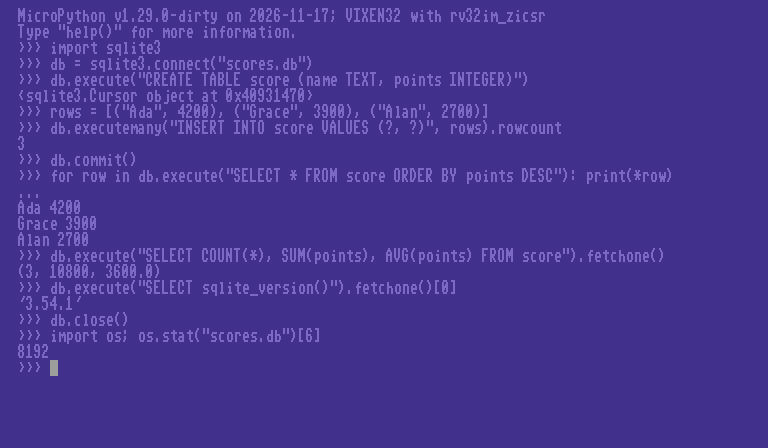

# SQLite databases

`import sqlite3` gives you real SQLite 3.54.1 databases, in memory or as
files on the SD card. The module is the DB-API core of CPython's `sqlite3`
(the micropython-sqlite3 project, which `setup.sh` fetches into
`deps/micropython-sqlite3`). It is in every build that has the network or LVGL.

```python
import sqlite3

db = sqlite3.connect("scores.db")          # relative to the current directory
db.execute("CREATE TABLE IF NOT EXISTS score (name TEXT, points INTEGER)")
db.execute("INSERT INTO score VALUES (?, ?)", ("Ada", 4200))
db.commit()                                 # now it is on the card

for name, points in db.execute("SELECT * FROM score ORDER BY points DESC"):
    print(name, points)
db.close()
```

`sqlite3.connect(":memory:")` works the same without touching the card.



## What it supports

Connections, cursors, `fetchone`/`fetchmany`/`fetchall`, iteration,
`executemany`, `executescript`, `?` and `:name` parameters, `Row` objects
(by index and by name), the DB-API exception classes and the pysqlite
transaction model: a DML statement opens a transaction, `commit()` ends it.
INTEGER values are full 64-bit. Not included: adapters/converters,
`backup()`, `with` blocks, `row_factory`. The module's README
(`deps/micropython-sqlite3/README.md`) has the complete list.

## How databases live on the card

The kernel opens a file on the SD card either for reading or for writing
from scratch: there is no read+write handle. SQLite needs both, so the
VIXEN keeps an open database in RAM:

- `connect()` reads the whole file into memory.
- SQLite works on that copy; rollback journals and temporary tables stay
  in RAM too.
- Every `commit()` writes the whole database to `<name>-vxtmp`, removes the
  old file and renames the new one into place.

The card therefore always holds the state of the last commit. A power cut
while the database is written leaves either the old database or the
complete `-vxtmp`; the next `connect()` cleans up or renames it back.
Uncommitted changes are lost on reset, as with any database.

What this means for your program:

- **Commit in batches.** Each commit writes the whole file, even when only
  one row changed. Insert a thousand rows and commit once, not a thousand
  times.
- **Size.** Opening reads the whole file, and the database occupies its
  size in Python heap while open. Kilobytes to a few megabytes are fine;
  the heap grows into the Zorro RAM when needed.
- **One program.** Two connections to the same file in one program share
  the data and lock each other like SQLite does elsewhere. BASIC or another
  machine writing the file while it is open is not seen.
- **No WAL.** `PRAGMA journal_mode=WAL` is not available (it needs shared
  memory); the default rollback journal is used.
- **Clock.** The VIXEN has no wall clock for SQLite yet: `date('now')`
  counts from 2000-01-01 00:00 at power-up.
- **Speed.** SQLite runs from chip RAM (through the cache) and computes
  with software doubles; simple queries on thousands of rows take a
  moment, not milliseconds.

## Measured

On the MEGA65 (core v0.98), a table of 20,000 rows (`INTEGER PRIMARY KEY`,
a short `TEXT`, a `REAL`), 472 KB on the card; wall clock from the PC
over SSH:

| Operation | Time |
| --- | --- |
| build the 20,000 rows in Python and insert them | ~16 s |
| `commit()` (writes the whole file) | ~1.5 s |
| `commit()` after changing one row | ~1.5 s |
| `connect()` (reads the whole file) | ~0.9 s |
| full scan: `COUNT`/`SUM` with `LIKE '%7%'` | ~2.3 s |
| for comparison: writing 472 KB from Python | ~1.9 s |

Writing back runs at about 300 KB/s, as fast as the card itself takes data.
Up to a few hundred KB a commit stays under a second.

## Quick check

On the VIXEN-32:

```python
import sqlite3, os
db = sqlite3.connect("t.db")
db.execute("CREATE TABLE t (a)")
db.executemany("INSERT INTO t VALUES (?)", [(i,) for i in range(1000)])
db.commit()
print(db.execute("SELECT COUNT(*), SUM(a) FROM t").fetchone())   # (1000, 499500)
db.close()
print(os.stat("t.db")[6])                                          # 20480: five 4 KB pages
os.remove("t.db")
```

## Building without it

`SQLITE=0` leaves the module out (about 640 KB of chip-RAM code):
`./build.sh SQLITE=0 BUILD=build-net`. The OS layer is
`ports/vixen/vixen_sqlite.c`; the emulator test is `tests/test_sqlite.py`.
